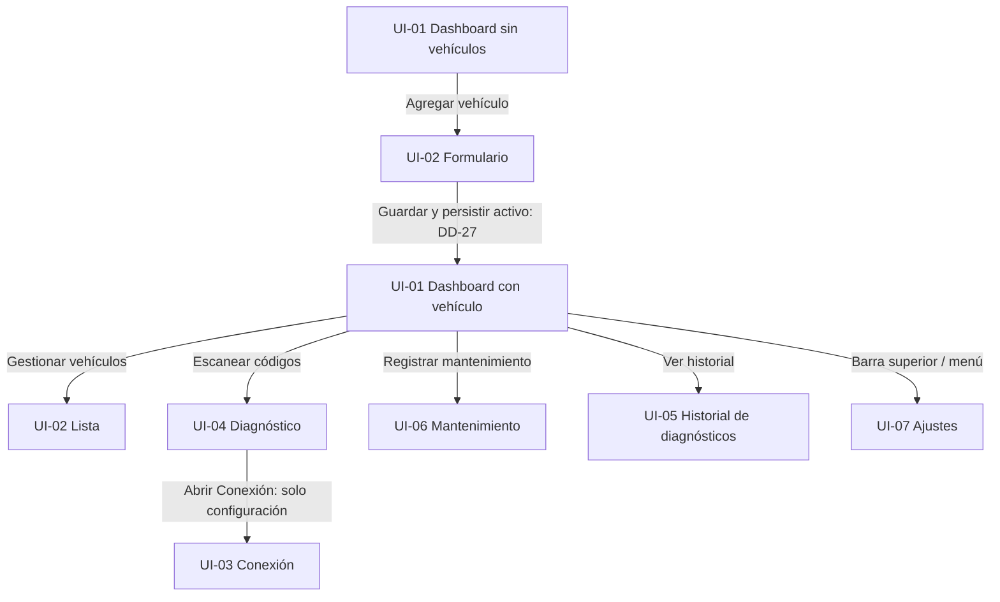
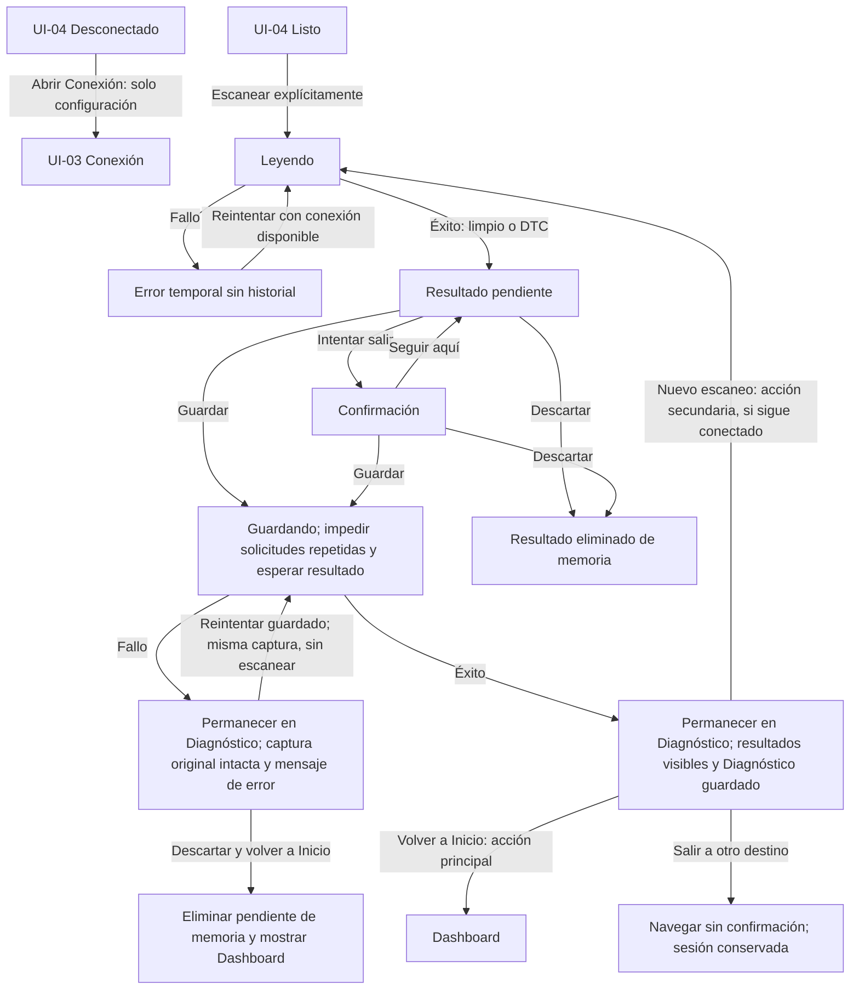
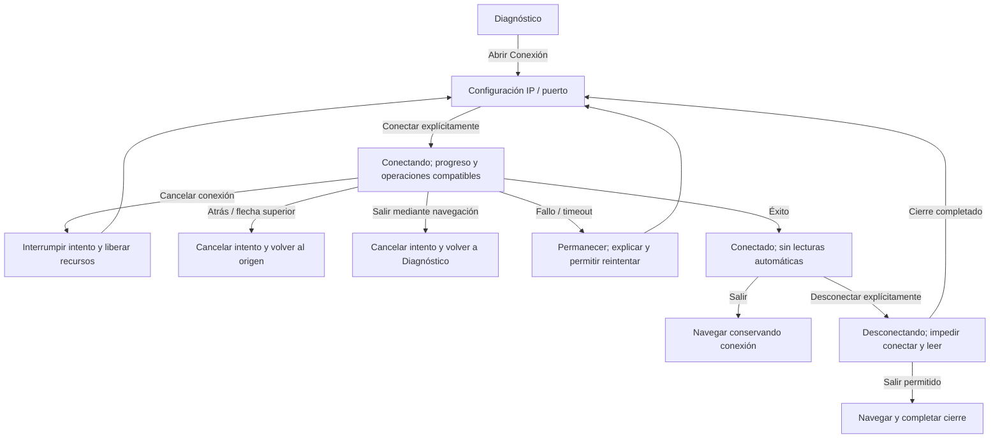
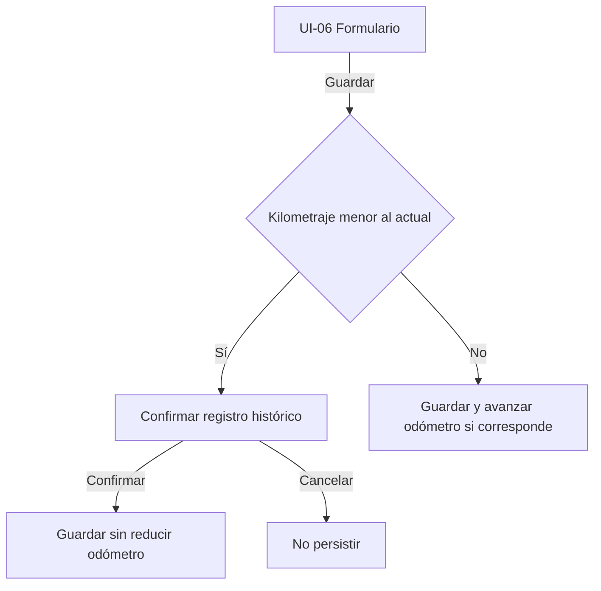

# Flujos de pantalla

## Reconciliación funcional 4.4 — 2026-11-10

La navegación técnica está conectada en `AppNavigation`, pero los destinos aún contienen texto mínimo; los siguientes recorridos son contratos, no pruebas de interacción ni DESIGN_READY. La captura Figma confirmada por revisión visual complementa la evidencia estructural previa: **11:42** renderiza “Aún no hay diagnósticos” (no es error de texto); **11:4** representa la barra inferior con texto compacto; **11:286** usa “Aceite” como ejemplo de tipo, no como selector final; **13:75** muestra el acceso para abrir Ajustes. La inspección estructural no demuestra comportamiento de controles. Variantes, contraste, accesibilidad, scroll/IME e interacción completa quedan pendientes.

| R | Origen / acción | Precondición y resolución | Éxito | Fallo / cancelación | Atrás / retorno |
|---|---|---|---|---|---|
| R01 | Barra principal → Inicio, Vehículos, Diagnóstico o Mantenimiento | Cuatro destinos principales; sin quinto destino para Ajustes | Una instancia del destino, preservando estado oficial de Navigation | La pantalla conserva estado/error recuperable; no inventar stack propio | Destinos secundarios retornan al origen |
| R02 | Inicio o Historial → detalle por sessionId | Cargar y validar existencia/contexto antes de atribuir datos | Mostrar sesión real del vehículo indicado | ID inexistente/contexto invalidado: estado recuperable, no mostrar datos de otro vehículo | Inicio → Inicio; Historial → lista del mismo vehículo |
| R03 | Cualquier acción → destino autorizado | Validar whitelist y argumentos positivos antes de retener autorización | Navegar y consumir solo el ID autorizado | Ruta inválida o excepción: limpiar autorización vigente, conservar UI y reportar error reintentable | Back hace pop; en raíz termina Activity y consume autorización |
| R04 | Vehículos → Usar, Editar o Eliminar de fila | Conexión activa bloquea selección/borrado y edición del vehículo activo; explicar que debe desconectarse para editar; confirmar cascada; captura pendiente se resuelve primero | Selección guarda ID; primer alta exitoso puede ir a Inicio | Fallo de selección conserva el vehículo creado y reintenta el mismo ID; borrado fallido refresca Room/DataStore, sin atomicidad supuesta | Editar vuelve a lista; alta del primer vehículo vuelve a Inicio |
| R05 | Formulario modificado / captura pendiente → salir | Primero resolver borrador local (Guardar solo en su acción explícita, Seguir/Descartar); luego captura Save/Discard/Stay; luego navegación | Ejecutar la intención original una sola vez | Cancelación/fallo no navega; captura nueva requiere decisión nueva; no mostrar diálogos simultáneos | Se conserva la pantalla/acción original conforme DD-25/30/31/35/36 |
| R06 | Diagnóstico → Conexión (F03) | Aviso Wi-Fi → concesión LAN real → validar IP/puerto → connect explícito → persistir config tras handshake | Connected conserva conexión; persistencia fallida reintenta solo DataStore | Formato inválido no abre socket; TCP/handshake conserva borrador; Cancelar Connecting cierra y queda en configuración | Toda salida final de F03 retorna a Diagnóstico; conectado conserva socket |
| R07 | Diagnóstico → escanear/guardar/descartar | Requiere Connected; captura Success inmutable pendiente hasta resolución | Guardado conserva resultado visible y captureId/ID | Failure no crea sesión; error de guardado conserva la misma captura; no reescaneo al retry | Stay permanece; Discard explícito según DD-25; salida global conserva intención |
| R08 | Diagnóstico, Mantenimiento o Historial sin vehículo → Agregar | Sin activo: no conectar, leer ni crear registro asociado a vehículo inexistente | Alta inicial reutiliza el flujo de Vehículos | Fallo de alta/selección conserva ID y permite retry | Tras guardar y seleccionar el primer vehículo, volver a Inicio |
| R09 | Inicio/Diagnóstico → Historial → detalle | Resolver vehicleId/sessionId, aislar vehículo, lista descendente | Lista incluye sesiones limpias y con códigos | Vacío distinto de error; ID ausente/contexto cambiado informa estado recuperable | Detalle retorna al origen; historial desde Inicio/Diagnóstico mantiene origen |
| R10 | Mantenimiento → registrar/editar | Ocho tipos (siete alertables + OTHER); guardias de fecha/km; confirmar kilometraje histórico | Alta o edición usa la operación existente; edición conserva ID | Error conserva borrador; OTHER no genera alerta automática | Cancelar vuelve sin modificar registro |
| R11 | Destino principal → Ajustes | Borrador común; Guardar explícito; defaults solo tras lectura exitosa | Persistir nombre/unidades/visibilidad; no reescribir km no editados | Error conserva borrador y consulta valor real antes de retry | 13:75 muestra acceso; regreso al origen según back stack |
| R12 | Inicio → mantenimiento, diagnóstico, métricas o último resultado | Jerarquía vehículo→mantenimiento→diagnóstico→métricas; estado asociado al vehicleId | Cada bloque abre contexto actual; diagnóstico limpio difiere de ausencia | Error conserva datos del mismo vehículo, no datos anteriores ajenos; sin métricas visibles se oculta bloque | Historial/detalle y secundarios retornan al origen |

### Decisiones de etapa 4.4

| ID | Propuesta actual | Estado / límite |
|---|---|---|
| D1 | Alta del primer vehículo desde vacío secundario termina en Inicio | APROBADA por el usuario; integración pendiente |
| D2 | Bloquear edición del vehículo activo conectado e indicar que debe desconectarse | APROBADA por el usuario; amplía DD-28; integración y guardia ante carreras pendientes |
| D3 | El bloque de códigos de Inicio abre detalle de última sesión; “Ver historial” permanece independiente | APROBADA por el usuario; integración pendiente |
| D4 | Apariencia A con paleta fija y versiones clara y oscura según el sistema | Dirección elegida; muestras, tokens, contraste y aprobación visual pendientes |

## F03: origen y destino MVP — 2026-11-10

Por decisión del usuario, el flujo de Conexión y métricas comienza en Diagnóstico; toda salida final del flujo vuelve a Diagnóstico, desde donde se puede navegar a Inicio. «Volver al origen» refiere a la pantalla que inicia el flujo. Las referencias anteriores a acceso directo desde Inicio o retorno final de F03 a Inicio quedan reemplazadas en ese alcance; Historial mantiene su propia regla de origen. Composición técnica F03 se integró en 4.3 y pasó instrumentadas de navegación/recreación según [reporte](../reporte_fase4_etapa4_3.md); el permiso runtime, controles y pantallas continúan pendientes en 4.6.

Revisión documental: 2026-11-07. Fuentes: MainActivity.kt y AndroidManifest.xml en app/src/main; [contexto](../Contexto_Maestro_App_OBDII_v2.md) §§12,16,20; [brief](../ux_fase1.md) “Navegación propuesta” y “Recorridos del prototipo”.

## Actualización DD-48 — conexión y última lectura

El usuario confirmó 1A/2A/3A el 2026-11-08: Inicio muestra estado textual de conexión; el acceso a Conexión pasa por Diagnóstico según la actualización F03 de 2026-11-10. Al desconectar conserva la última lectura completa del vehículo, con fecha/hora y estado desconectado; cada parámetro visible no disponible se identifica como tal. Se mantienen estados transitorios reales, «Sin lectura» y las preferencias de visibilidad DD-29.

## Actualización DD-47 — resultado e historial diagnóstico

El usuario confirmó 1A/2A/3A/4A el 2026-11-08. Resultado con DTC → mostrar código real y descripción local; si no existe, explicar ausencia de información local sin inventar causas. Diagnóstico limpio guardado → «Sin códigos detectados», fecha/hora y estado guardado. Historial → sesiones más recientes primero con fecha/hora, kilometraje local capturado y cantidad de códigos. Mantener DD-25 para guardar, reintentar, descartar y volver.

## Actualización DD-46 — estados vacíos de Inicio

El usuario confirmó A/A el 2026-11-08. Sin mantenimiento del vehículo activo, mostrar «Aún no hay mantenimientos» con acceso a Mantenimiento para registrar; sin diagnóstico guardado, «Aún no hay diagnósticos» con acceso a Diagnóstico. Son vacíos distintos de fallo y de un diagnóstico limpio guardado; mantener la jerarquía DD-45.

## Actualización DD-45 — jerarquía de Inicio

Confirmado A/A por el usuario el 2026-11-08: vehículo activo → mantenimiento y vencimientos → diagnóstico → métricas OBD. Activar el resumen de mantenimiento abre Mantenimiento del vehículo actual. Las preferencias de visibilidad DD-29 y la navegación principal DD-13 permanecen vigentes.

## Actualización DD-44 — orden y programación de Mantenimiento

Confirmado 1A/2A/3A el 2026-11-08: mostrar intervenciones más recientes primero; mantener visibles en el formulario los campos opcionales de próxima fecha y próximo kilometraje; indicar con texto el estado calculado de la programación vigente cuando corresponda. No atribuir ese estado a registros históricos ni inventar una alerta para OTHER. Reglas de fechas y kilometrajes sin cambios.

## Actualización DD-43 — lista de Mantenimiento

El usuario confirmó 1A/2A/3A el 2026-11-08. Mantenimiento muestra tipo, fecha, kilometraje y próximos límites disponibles por registro; destacar «Registrar mantenimiento» y ofrecer edición desde cada registro. Si no hay registros, mostrar «Aún no hay mantenimientos» y la acción de registrar. Registrar crea intervención; editar conserva el mismo ID (DD-16); límites de un registro no se confunden con programación vigente. Carga/error y vacío siguen DD-40.

## Actualización DD-42 — lista y formulario de Vehículos

Confirmado 1A/2A/3A el 2026-11-08: cada fila muestra marca, modelo, año informado, kilometraje y etiqueta Activo cuando corresponde; un vehículo no activo ofrece «Usar este vehículo» en su propia fila y editar/eliminar en su menú. Alta y edición comparten formulario con título y acción adaptados; combustible y motor se consultan en edición. Se mantienen guardias y destinos DD-27/28 y descarte DD-30. Representación y accesibilidad por validar.

## Actualización DD-40/41 — listas y fecha de Inicio

El usuario confirmó 1A y 2A el 2026-11-08. Vehículos, historial y mantenimiento aplican el patrón de DD-39: primera carga/error completos cuando no hay datos del contexto; actualización conserva datos del mismo contexto, informa fallo y ofrece Reintentar. Un vacío exitoso no es un error. Al cambiar vehículo no se presentan datos de otro como actuales.

Inicio recalcula vencimientos al abrir o volver a activarse usando la fecha actual. No se exige actualización al cruzar medianoche si permanece visible; puede actualizarse antes por otro evento que ya recalcule. Implementación, recuperación de flujos y pruebas pendientes.

## Actualización DD-39 — carga y error de Inicio

Opción B confirmada el 2026-11-08: primera carga sin datos disponibles del vehículo actual → carga completa; fallo → mensaje y Reintentar. Actualización posterior → conservar datos previos del mismo vehículo e indicar actualización; fallo → advertir posible desactualización y ofrecer Reintentar. No presentar datos de otro vehículo como actuales. Sin vehículos sigue siendo un estado vacío independiente. Presentation y recuperación efectiva de flujos pendientes.

## Actualización DD-38 — recurrencia en Inicio

Confirmación del usuario, 2026-11-08: Inicio muestra todos los códigos de la última sesión guardada y etiqueta «Recurrente» los detectados automáticamente en sesiones exitosas anteriores del mismo vehículo. No es favorito ni preferencia manual; no se agrega aviso separado ni se mezcla con alertas de mantenimiento. Esta decisión resuelve la presentación de recurrencia de RF-05 dentro de DD-09/18; no implementa ni aprueba el diseño visual. Véase [DD-38](design-decisions.md#dd-38-recurrencia-de-códigos-en-inicio).

## Actualización DD-37 — entrada en millas

Condición confirmada por el usuario el 2026-11-08: B al no requerir cambios del backend. Las entradas de distancia en millas admiten un decimal; Presentation convierte a kilómetros y redondea al entero más cercano al guardar. Domain/Data conservan Int en km y validaciones existentes. Un campo sin editar conserva su entero original; cambiar solo unidades no reescribe datos. El redondeo implica que el valor mostrado al volver puede diferir ligeramente. Sustituye las referencias históricas que dejan pendiente esta precisión.

## Actualización DD-36 — guardado de Ajustes

Confirmada opción B por el usuario el 2026-11-08: nombre, unidades y visibilidad se editan en un borrador común y se confirman con Guardar; antes de guardar permanecen vigentes las preferencias anteriores. Salida con cambios → «¿Descartar los cambios?» → Seguir editando o Descartar; salida sin cambios, directa. Ante fallo se informa, se conserva borrador y se consulta estado real antes de reintentar; no se presupone atomicidad. La recreación sigue DD-32. Unidades mantienen significado y datos almacenados según DD-22/31; precisión y redondeo de millas se resolvieron posteriormente en DD-37. Sustituye sugerencias históricas de guardado inmediato y referencias anteriores a este punto como pendiente.

## Actualización DD-35 — salida con configuración modificada

Confirmada opción B por el usuario, 2026-11-08. IP o puerto modificados sin intento de conexión → Atrás/flecha/cambio de destino → «¿Descartar los cambios?» → Seguir editando conserva borrador y cancela navegación / Descartar vuelve al destino solicitado sin modificar configuración persistida. Sin cambios se sale directamente; volver a valores originales elimina cambios pendientes y cerrar teclado no es salir. Tras handshake y ante fallo de persistencia siguen las reglas propias del flujo existente. DD-30 aplica el mismo patrón a vehículos y mantenimiento; diagnósticos pendientes y operaciones en curso conservan DD-25/26/28/33. Ajustes sigue con guardado por definir. Sustituye referencias históricas que consideren abierto este caso.

### Bifurcación F03 — entrada inválida (flujo aprobado tras revisión del usuario)

Al pulsar Conectar, validar IP/puerto antes de construir `ObdConnectionConfig` o iniciar el socket. Si el formato es inválido, permanecer en Configuración, señalar el campo, conservar ambos valores y ofrecer corregir/reintentar o cancelar. Corregir vuelve a validar y, si es válido, inicia el flujo normal de conexión. Cancelar vuelve al origen sin guardar el borrador. Si el formato es válido pero falla TCP o la inicialización ELM327, mostrar el error de conexión conservando los campos y ofrecer reintentar la conexión o volver a corregirlos/cancelar. Un handshake exitoso continúa al estado Conectado y entonces persiste IP/puerto; un fallo de persistencia conserva la conexión activa y permite reintentar solo el guardado (DD-35).

El contrato Domain valida IPv4 y puerto 1–65535 al construir `ObdConnectionConfig`; `Elm327ObdGateway.connect` devuelve `ObdResult.Failure` y deja `Error` para fallo de socket/protocolo. Validación de formulario, conservación de borrador, navegación de cancelación y persistencia tras handshake pertenecen a Presentation/coordinación aún pendientes.

## Actualización DD-34 — recuperación del permiso LAN

Confirmada opción C por el usuario el 2026-11-08: al denegar el permiso, explicar su necesidad y ofrecer reintento si Android permite solicitarlo de nuevo; si no, orientar a ajustes de la aplicación. Al regresar comprobar la concesión real antes de conectar, sin suponer que abrir ajustes concede permiso. La detección por versión de plataforma y la interfaz siguen pendientes de implementación y validación. Esta regla completa la comprobación al pulsar Conectar ya acordada.

## Actualización DD-33 — salida voluntaria durante lectura

Confirmación del usuario, 2026-11-08: opción C. Atrás o cambio de pantalla durante una lectura de parámetros o DTC cancela la operación y permite salir; se descarta la captura incompleta, se conserva la última captura completa y se comunica el estado real de conexión. Cancelar puede cerrar el socket; no reconectar automáticamente. Desconectar explícitamente interrumpe la lectura y, si hay un diagnóstico previo pendiente, primero se resuelve según DD-17/28. La recreación no es salida y conserva la operación según DD-32. Coordinación e interfaz pendientes; Figma no actualizado. Esta decisión reemplaza las referencias históricas inferiores que consideran este punto abierto.

## Decisiones y propuestas de interacción — revisión posterior

- El usuario indica descartar lecturas OBD incompletas al salir o desconectar. La cancelación actual cierra el socket; reintentar requiere reconexión explícita. Conservar la última captura completa anterior; no publicar ni guardar la parcial. La salida exacta durante lectura y coordinación con una captura diagnóstica previa se detallarán en Presentation.
- Aprobado: implementar en fase 4 alertas de error con explicación clara y acciones de reintento o descarte adecuadas a la operación, conservando datos; orientar sobre fallos de software sin mostrar datos sensibles ni detalles internos confusos. Hoy no existe UI de errores. Mantener almacenamiento MVP en kilómetros enteros; mayor precisión queda fuera de alcance. Precisar formato y redondeo de entrada en millas antes de implementar sin prometer precisión superior.
- Aprobación histórica, actualizada para F03 el 2026-11-10: el flujo se inicia desde Diagnóstico y sus salidas finales vuelven allí. Primero mostrar «Debe conectarse a Wi-Fi del adaptador para continuar», con Siguiente y Cancelar; Cancelar vuelve a Diagnóstico. Siguiente continúa con comprobación del permiso según Android, validación de IP/puerto, conexión explícita y guardado de configuración tras handshake exitoso. El aviso no demuestra conexión a la red correcta. Si falla conexión conservar entrada y ofrecer reintento o descarte; si falla persistencia conservar conexión y reintentar solo guardado. Antes de cambiar IP/puerto con conexión activa solicitar desconectar; no provocar error ni reconexión silenciosa. El usuario conecta el móvil a la red del adaptador; IP/puerto configurables, no asumir descubrimiento automático. Resolver salida con campos modificados.
- Permiso LAN aprobado: comprobar al pulsar Conectar y solicitar si falta según Android; repetir comprobación tras reinicio/revocación, sin prometer que el sistema muestre un diálogo cuando ya existe concesión. Denegación y recuperación se diseñarán según plataforma.
- El usuario indica volver a Inicio tras descartar diagnóstico. Resolver captura pendiente antes de un nuevo escaneo con opciones coherentes de guardar, descartar con advertencia o seguir; reintentar una lectura fallida no equivale a descartar una captura válida previa.
- Detalle de diagnóstico: aprobado volver al origen; desde Inicio vuelve a Inicio y desde historial vuelve a la lista. Abrir el detalle no inicia escaneo.

## Navegación técnica implementada en 4.3

Launcher → MainActivity → BitacoraOBDTheme → AppNavigation/NavHost. Navigation Compose ofrece home, vehicles, diagnostic, maintenance, settings, history/{vehicleId}, diagnostic-detail/{sessionId} y connection bajo el grafo F03 iniciado en diagnostic. Rutas usan IDs, el back stack es de Navigation y las acciones sensibles pasan por AppSession. R03 valida destino/IDs antes de autorizar; una excepción de navegación libera autorización con error recuperable; Back en raíz finaliza Activity. Evidencia instrumentada y limitaciones en [reporte 4.3](../reporte_fase4_etapa4_3.md).

Los destinos aún contienen Text técnico; no hay barra de producto, formularios, controles o UI funcional. Dashboard visual y pantallas siguen planificados. Esta integración no acredita DESIGN_READY ni prototipo.

## Recorridos documentados, aún no implementados

Identificadores compartidos con [ui-ux-specification](ui-ux-specification.md). El estado DRAFT correspondía a la revisión inicial; el usuario aprobó los wireframes revisados UI-01–UI-07 el 2026-11-09. Las variantes posteriores requieren revisión y ningún paquete es DESIGN_READY. Los diagramas representan requisitos y decisiones funcionales, no navegación ejecutable; FigJam no acredita por sí solo prototipo interactivo ni accesibilidad.

Alternativa A APROBADA por el usuario en chat (2026-11-07; DD-13): barra inferior con Inicio, Vehículos, Diagnóstico y Mantenimiento. Desde 2026-11-10 Conexión se inicia desde Diagnóstico y termina allí; Historial diagnóstico se abre desde Inicio o Diagnóstico y retorna al origen. Ajustes (UI-07, DD-23) se abre desde barra superior o menú y vuelve al origen, conservando los cuatro destinos principales. Implementación pendiente.

### Punto 3: activo al crear vehículos (DD-27, aprobado)

Aprobación funcional explícita en chat (2026-11-07); implementación pendiente. El diagrama inicial representa el alta del primer vehículo conforme a DD-27.

- Primer vehículo: Inicio vacío → Agregar → Guardar vehículo en Room → Persistir ID devuelto como activo en DataStore → Inicio con ese vehículo.
- Vehículo adicional: Agregar → Guardar → Conservar el activo válido actual. Cambiar al nuevo requiere selección explícita, sin casilla o diálogo adicional al guardar.
- Reapertura: ID persistido válido → Mantener activo. Si falta o no existe → Primer vehículo disponible, como el fallback actual → Persistir esa selección mediante coordinación explícita. Sin vehículos → Inicio vacío.
- Fallo parcial: vehículo guardado pero selección no persistida → Informar qué se guardó → Reintentar solo persistencia de selección; no volver a insertar ni afirmar que el activo quedó guardado.

El repositorio actual no activa automáticamente al crear; Dashboard usa el primer disponible como fallback sin reparar DataStore. La implementación debe coordinar las operaciones existentes, respetando guardias OBD, sin escrituras dentro del Flow de consulta, nuevas tablas, campos o dependencias. Room y DataStore no comparten transacción. Destino tras crear vehículos adicionales y ubicación del selector definidos en DD-28.

### Punto 4: selector y destinos de gestión (DD-28, aprobado)

Aprobación funcional explícita en chat (2026-11-07); implementación pendiente.

- Cambiar activo: Inicio → Cambiar junto al vehículo actual → Lista de Vehículos con etiqueta Activo → Usar este vehículo → Persistir selección → Inicio con el elegido. Fallo → Permanecer en lista, explicar y no anunciar éxito. Reutilizar la misma lista, sin selector/modal adicional.
- Agregar uno adicional: Vehículos → Agregar → Guardar → Lista de Vehículos; conservar activo según DD-27.
- Eliminar: Vehículos → Eliminar → Confirmar vehículo e historial diagnóstico/mantenimientos asociados → Borrar. Cancelar → No borrar. Con vehículos restantes → Permanecer en lista; conservar activo o mostrar siguiente activo si se borró el activo. Sin vehículos → Inicio vacío.
- Fallo al eliminar → Permanecer, explicar y refrescar el estado real. No ofrecer Deshacer sin soporte real de recuperación. Preferencias y Room no comparten transacción; el activo podría haber cambiado antes del fallo de borrado.
- Conectado → Bloquear cambio de activo y cualquier borrado; explicar que debe desconectar primero. Mientras finaliza cancelación/desconexión → No habilitar cambios incompatibles. Si existe una captura diagnóstica pendiente, resolver primero guardar, descartar con advertencia o seguir aquí; falta implementar esa coordinación.

### Punto 5: métricas compartidas y visibilidad (DD-29, aprobado)

Alternativa B aprobada funcionalmente en chat (2026-11-07); implementación pendiente.

- Lectura: Diagnóstico → Abrir Conexión (solo configuración) → Conectar explícitamente → Leer parámetros → Leyendo → Captura compartida: vehículo, fecha/hora, RPM, refrigerante y velocidad → Volver al origen. En Inicio se muestra esa misma captura en formato compacto; volver no genera otra lectura. Actualizar lectura requiere pulsación explícita.
- Personalización: Destino principal → Ajustes → Dashboard → Métricas visibles → Activar/desactivar RPM, temperatura del refrigerante y velocidad → Persistir preferencia global. Las tres activadas por defecto y en orden fijo; todas desactivadas → Ocultar bloque de métricas en Dashboard. Regla funcional aprobada; guardado y recuperación se concretaron posteriormente en DD-36.
- Los interruptores solo filtran Inicio. Conexión conserva todos los parámetros; no cambian comandos ni adquisición OBD. Kilometraje, último diagnóstico y mantenimiento conservan sus bloques actuales, fuera de esta selección.
- Sin captura → Sin lectura. null → No disponible, distinto de cero. Usar unidades de DD-22 y mostrar Última lectura con fecha/hora; desconectado indicar ese estado. No trasladar capturas a otro vehículo. Resultados parciales conservan sus valores válidos; no mezclar antiguos con nuevos como si fueran una captura.
- Sin lecturas al abrir/conectar, polling, nuevos sensores o historial de métricas. Durante lectura mostrar progreso indeterminado y evitar repetición/operaciones OBD simultáneas desde UI. Fallo → explicar y reintentar si sigue conectado; si se perdió conexión → reconexión explícita. Lectura previa conservada se identifica como anterior.
- Adquisición soportada por ObdGateway/ObdLiveMetrics; falta estado temporal compartido y coordinación en Presentation, más preferencias nuevas en AppPreferencesRepository/DataStore. Sin ampliar DashboardSummary, Room o dependencias. Salida durante lectura pendiente de concretar, distinta de Connecting.

Conexión e Historial retornan al origen según DD-13. Guardado exitoso y fallo de persistencia quedan consensuados por DD-25 (2026-11-07); no hay UiState implementado.

### Guardado y continuidad de diagnóstico aprobados (DD-25)

- Resultado pendiente → Guardar → Guardando. Impedir solicitudes repetidas y esperar el resultado antes de descartar o salir.
- Fallo → Permanecer en Diagnóstico, conservar vehículo/fecha-hora/kilometraje/códigos originales y mostrar “No se pudo guardar el diagnóstico”. “Reintentar guardado” vuelve a guardar esa captura, sin escanear. “Descartar y volver a Inicio” elimina solo el pendiente de memoria y abre Dashboard; no añade otra confirmación si la consecuencia está explícita.
- Éxito → Permanecer en Diagnóstico con los resultados visibles y etiqueta persistente “Diagnóstico guardado”, acompañada de fecha/hora de la captura. Retirar Guardar y Descartar. “Volver a Inicio” es la acción principal; “Nuevo escaneo” es secundaria, disponible si sigue conectado, conserva la sesión guardada e inicia otra captura. Salir no requiere confirmación porque ya no hay pendientes. No obligar a volver al Dashboard para reescanear.
- El estado guardado confirma persistencia, no ausencia de fallas del vehículo. Un aviso breve puede reforzarlo, sin sustituir la etiqueta persistente.
- Implementar estados y coordinación en Presentation. La evaluación anterior suponía que no serían necesarios cambios en Domain, Room ni esquema; queda pendiente determinar en el plan técnico cómo evitar duplicados ante un resultado de guardado incierto, ya que el repositorio inserta una nueva sesión por llamada. Ver [contraste de contratos](domain-contracts.md#ampliación-del-contraste-por-operación--paso-3). Recuperación tras cierre forzado permanece fuera del MVP.

La actualización posterior indicada al inicio establece volver a Inicio tras descartar y resolver una captura pendiente antes de reescanear. Con captura pendiente, resolver guardar/descartar/seguir aquí antes de desconectar o cambiar vehículo; DD-25 no autoriza eliminar capturas silenciosamente.

### Conexión: apertura, espera y salida aprobadas (DD-20/DD-26)

Confirmaciones del usuario en chat, 2026-11-07. Implementación de Presentation pendiente.

- “Abrir Conexión” solo muestra configuración. Conectar comienza por acción explícita, sin lecturas automáticas.
- Durante el intento impedir operaciones incompatibles, mostrar progreso y “Conectando… Si sales, se cancelará el intento”; no bloquear globalmente la aplicación.
- “Cancelar conexión” interrumpe el intento, libera recursos y permanece en Conexión. Atrás/flecha superior o salida mediante navegación cancela y vuelve a Diagnóstico; desde allí se elige otro destino. No añadir diálogo de confirmación. La cancelación voluntaria no es un fallo.
- Fallo/timeout conserva Conexión con explicación y reintento; éxito muestra Conectado y permite volver al origen.
- Durante Disconnecting permitir salir y completar el cierre de recursos; impedir conectar/leer hasta terminar y evitar desconexiones repetidas.
- En Connected, salir conserva la conexión; desconectar requiere acción explícita. Salir durante un intento no debe dejarlo iniciándose fuera de pantalla.

La cancelación y navegación deben coordinarse desde Presentation. Una captura pendiente debe resolverse antes de desconectar o cambiar vehículo; salir de Conexión no autoriza descartarla.

SaveMaintenanceUseCase y RoomMaintenanceRepository admiten inserción y actualización del mismo ID, con validaciones DD-30; diálogos y navegación siguen pendientes.

### Edición de mantenimiento aprobada (backend implementado; UI pendiente)

Detalle del registro → Editar → Formulario precargado → Guardar cambios → Actualizar el mismo ID → Recalcular programación vigente y alertas. Cancelar → Volver al detalle con registro original inalterado. No crear un registro adicional ni conservar versiones de la edición.

Se permite cambiar fecha realizada. El último registro por fecha realizada/ID determina la programación de cada tipo: una corrección puede hacer vigente otro registro, incluso vencido. La próxima fecha/kilometraje son límites absolutos; no existen intervalos para desplazarlos automáticamente al corregir fecha realizada. Validaciones de Domain implementadas; comunicación del efecto en UI pendiente.

### Punto 6: salida de formularios y validación de mantenimiento (DD-30, aprobado)

Aprobación funcional explícita en chat (2026-11-07); implementación pendiente en formularios de alta/edición de vehículos y mantenimiento.

- Formulario sin cambios → Atrás/flecha/cambio de destino → Volver directamente. Con cambios → Intentar salir por Atrás/flecha/pestaña → ¿Descartar los cambios? → Seguir editando conserva borrador / Descartar vuelve sin alterar original.
- Cancelar explícito → Descartar borrador → Volver con registro original inalterado. Campos restaurados a sus valores originales → Sin cambios pendientes. Cerrar teclado no abandona formulario.
- Guardar → Validar → Persistir. Fallo → Permanecer, explicar y conservar valores para reintentar.
- Mantenimiento: fecha realizada ≤ hoy; próxima fecha opcional ≥ realizada; próximo kilometraje opcional ≥ kilometraje de la intervención; kilometrajes no negativos. Límites ya vencidos respecto de hoy/kilometraje actual siguen permitidos, incluida igualdad.
- Corregir fecha realizada → Mostrar “Esta corrección puede cambiar la programación vigente y las alertas” → Guardar mismo registro → Consultar estado recalculado. Sin simulación previa; próximos límites absolutos conservados, sin desplazamiento automático.

Validaciones de Domain implementadas; control de borrador y mensajes de Presentation pendientes. No cambia opcionalidad de Vehicle ni sustituye reglas específicas de conexión/diagnóstico.

## Punto 7: Ajustes y unidades (DD-31, aprobado)

Regla aprobada en chat (2026-11-07): evitar cambios de contexto durante la edición de datos. No mostrar Ajustes junto a un formulario ni conservarlo detrás como borrador suspendido, también en pantallas amplias.

- Acceso: Formulario → Guardar o descartar → Cerrar → Destino principal → Barra superior/menú → Ajustes. Una salida con cambios aplica DD-30: Seguir editando cancela salida; Descartar cierra sin guardar. Sin cambios, cerrar directamente. No guardar silenciosamente ni abrir Ajustes antes de resolver el borrador.
- Preferencias: Ajustes → Nombre opcional / Distancia / Temperatura / Dashboard: Métricas visibles → Persistir preferencias locales → Volver al origen. El momento de persistencia y manejo de error aún necesitan ratificación.
- Unidades: Elegir preferencia → Conservar cantidades internas, registros y vencimientos → Convertir representación con unidad visible → Nuevos formularios usan preferencia vigente. No cambiar solo etiqueta conservando el mismo número; no mantener unidades antiguas mediante un editor abierto detrás de Ajustes.
- Comunicación: “Cambiar las unidades solo modifica cómo se muestran los datos. Tus registros y vencimientos se mantienen”. Texto informativo en Ajustes, sin confirmación por cada cambio.

DD-29 conserva los interruptores de RPM, temperatura del refrigerante y velocidad, inicialmente activados y en orden fijo. Preferencia global; permitir desactivar todos y ocultar su bloque en Inicio sin alterar adquisición ni Conexión. DD-22 conserva km/millas con velocidad vinculada km/h/mph, °C/°F, defaults km/°C y RPM fijo. No reinterpretar/regrabar históricos ni alterar alertas.

La regla de navegación y significado de los datos queda aprobada; las propuestas posteriores se resolvieron mediante guardado explícito DD-36 y conversión/redondeo DD-37. No confundir esos pendientes con la regla ya cerrada de no suspender formularios detrás de Ajustes. Implementación pendiente.

## Punto 8: continuidad ante cambios de configuración (DD-32, aprobado)

Aprobación funcional explícita en chat (2026-11-07); implementación pendiente:

- Formulario / pantalla actual → Rotar, redimensionar o plegar/desplegar con el proceso vivo → Misma pantalla, vehículo, borrador, errores y posición de scroll. Mantener cambios pendientes; no descartar, pedir confirmación ni abrir Ajustes por recreación.
- Resultado diagnóstico pendiente → Cambio de configuración → Misma captura original pendiente, con vehículo/fecha-hora/kilometraje/códigos. Métricas → Mantener captura y antigüedad; no hacer otra lectura.
- Conectando / Leyendo / Guardando → Cambio de configuración → Continuar la misma operación → Mostrar su resultado real; no lanzar otra conexión, lectura o inserción al recrear. Fallo real → Flujo de error correspondiente.
- Terminación del proceso → Reabrir y recargar Room/DataStore → Desconectado, sin comandos o guardados automáticos. Datos guardados permanecen; recuperación de borradores/capturas no persistidos fuera del alcance aprobado.

Recomendación explícita de implementación: representar estos estados en UiState expuesto por StateFlow desde ViewModels con alcance adecuado, conservar en ellos borradores, errores, captura pendiente y estado de operaciones, y observarlos desde Compose independientemente de orientación/rotación. El ViewModel debe sobrevivir a la recreación de Activity; no crear una operación nueva por recomposición. Complementar con estado guardable de navegación/scroll y una instancia OBD compartida fuera de composables recreables. No serializar sockets ni trabajos; ViewModel no sobrevive a terminación del proceso. Sin bloquear orientación ni añadir configChanges como atajo; sin serializar sockets, tablas o servicios nuevos. Presentation/coordinación pendientes de implementación. Esto no define salida voluntaria durante lectura ni navegación con un diagnóstico pendiente.

## Odómetro del escáner como referencia futura (DD-21)

Actualmente no se lee odómetro OBD. El recorrido siguiente solo se habilitará tras comprobar soporte y ampliar adquisición/persistencia; no es funcionalidad implementada ni promesa de compatibilidad.

Última lectura válida del vehículo (valor, fecha/hora y procedencia) → “Usar este valor” → Edición del mismo vehículo con kilometraje precargado → Revisar → Guardar o Cancelar.

- La lectura se conserva como referencia independiente de los campos actuales de Vehicle; el usuario no puede editarla.
- Se mantiene solo la última captura válida por vehículo. Otra captura válida la sustituye; no se crea un historial completo.
- Fallo/no disponible no es cero ni elimina la captura anterior. Mostrar siempre fecha/hora para reconocer antigüedad.
- Copiar/precargar no persiste el kilometraje. Solo Guardar en la edición manual modifica el valor local; Cancelar conserva valor previo y captura.
- Nunca sobrescribir automáticamente el kilometraje del vehículo desde OBD ni escribir en ECU. La apertura de pantalla no inicia lecturas.
- mileageAtScanKm sigue siendo una captura del kilometraje local del vehículo durante el diagnóstico, no una lectura del odómetro de ECU.

## Restricciones y caminos alternativos

- Cambiar activo conectado: bloqueo y explicación de desconectar primero (contexto §12.3 y brief). No hay selector implementado; setActiveVehicleId no impone guardia.
- DeleteVehicleUseCase devuelve Connected ante cualquier borrado estando Connected. DD-28 confirma cascada y destinos: si quedan vehículos, lista; al eliminar el último, Inicio vacío. Implementación UI pendiente.
- Conexión: apertura explícita según DD-20; cancelación directa y salidas de Connecting/Disconnecting según DD-26. En Connected, navegar conserva la conexión. Guardias y coordinación de Presentation pendientes.
- Escaneo pendiente: antes de salir/cambiar flujo, decidir guardar o descartar; “Seguir aquí” cancela salida según brief. No se recupera tras cierre forzado.
- Historial: únicamente sesiones guardadas, aisladas por vehículo; los intentos fallidos no crean destino histórico.
- Si coinciden conexión y captura pendiente, resolver primero guardar/descartar/seguir aquí; solo después desconectar antes de cambiar vehículo. La coordinación de Presentation está pendiente.
- No lectura automática por entrar a una pantalla ni sondeo continuo.
- Atrás/cambio de destino durante conexión definidos funcionalmente en DD-26, sin implementación. DD-31 define cierre de edición antes de Ajustes; DD-32 aprueba preservación durante rotación/recreación y recomienda estados/operaciones en ViewModels, con implementación pendiente. Deep links y estructura de back stack pendientes de definición.

## Estado de FigJam — 2026-11-08

Se sincronizaron parcialmente mapa, F01–F08 y el panel histórico con las decisiones posteriores; F09/F10 quedaron sin cambios. Ver alcance, nodos y límites en [referencias](figma-references.md#figjam--sincronización-funcional-parcial-2026-11-08). El saldo siguiente es histórico y sus temas funcionales fueron actualizados por DD-33–48; siguen pendientes la comprobación detallada del tablero y el diseño/interacción de las pantallas.

## Saldo de la revisión final de flujos

Revisión de documentos y lectura remota del FigJam en esta conversación (2026-11-07). DD-32 aprobado; no quedan por aprobar los acuerdos funcionales DD-25 a DD-32 dentro de su alcance explícito. Esto no equivale a flujos completos o implementados: DD-31 dejó guardado/redondeo pendientes y DD-32 no define salidas voluntarias.

### Decisiones e interacciones todavía abiertas

| Tema | Qué falta cerrar |
|---|---|
| Ajustes | Momento de guardado de interruptores/unidades, editor de nombre y manejo de fallo de persistencia. Siguen propuestas las opciones del punto 7; no inferir aprobación por la regla de cerrar formularios. |
| Entrada en millas | Precisión visible/permitida y redondeo al km entero al introducir valores nuevos. Cambiar solo preferencia mantiene los datos internos, como ya está aprobado. |
| Lectura OBD en curso | Efecto de Atrás/cambio de pestaña/Desconectar durante lectura de parámetros o DTC: terminar o cancelar y qué estado de conexión queda. Rotación conserva la operación (DD-32); no confundirla con salida voluntaria (DD-26 cubre Connecting). |
| Diagnóstico pendiente | Volver a Inicio tras descartar y resolver el pendiente antes de reescanear constan en la actualización posterior. Cambio de vehículo/desconexión requieren resolver antes guardar, descartar o seguir aquí; verificar detalles de interacción en diseño. |
| Configuración IP/puerto | La actualización posterior aprueba guardar tras handshake y reintentar solo la persistencia si falla; concretar salida con campos modificados. Son operaciones separadas en el contrato; Conectar no persiste por sí mismo la configuración. |
| Permiso de red local | Especificar solicitud contextual antes de conectar en Android 17/API 37, concesión/denegación, revocación y acceso voluntario a Ajustes del sistema si corresponde. El manifiesto declara ACCESS_LOCAL_NETWORK y targetSdk=37; no se encontró solicitud/comprobación runtime en app/src/main. Requisito Android, no comportamiento ya implementado. |

Fuente de permiso: [Android — Local network permission](https://developer.android.com/privacy-and-security/local-network-permission), consultada en esta revisión. Declararlo en manifiesto no sustituye su autorización en ejecución en API 37 para el acceso TCP local utilizado.

### Implementación y coherencia técnica pendientes

- Presentation, navegación, ViewModels/UiState/StateFlow y coordinación OBD todavía no existen como pantallas funcionales. Implementar las guardias y evitar reinicios/dobles guardados por recreación conforme a DD-32.
- Conectar la edición y validaciones ya implementadas a UI; consumir codesInLastSession y coordinar recálculo calendario al reanudar/cambiar de día.
- En formulario de Vehicle mostrar year=0 como vacío o no informado; no convertirlo en obligatorio ni mostrar cero como año real.
- Ampliar DataStore para nombre/unidades/visibilidad y componer captura de métricas por vehículo; no añadir tablas ni sensores por esta revisión.
- Incorporar en UI los cuatro tipos nuevos ya implementados con programación opcional; OTHER usa notas y no genera alertas.
- Deep links y estructura interna de back stack son trabajo de navegación pendiente, sin añadir requisitos fuera del MVP. Completar estados vacíos/carga/error y diseño visual/accesibilidad; no acreditan otra aprobación funcional por sí mismos.

### Documentación y FigJam

FigJam sincronizado posteriormente por autorización explícita del usuario, tomando estos archivos como fuente de verdad funcional. Se actualizaron mapa y F01–F06; F07 incorpora Ajustes/unidades/Dashboard, F08 formularios, F09 rotación con ViewModels y F10 odómetro futuro. El tablero conserva casos abiertos históricos y requiere actualizarse tras autorización para reflejar decisiones posteriores; no se cerraron por dibujarlos. Registro de nodos y evidencia de comprobación en [figma-references](figma-references.md). No implica aprobación visual de pantallas Android.

## Figma y evidencia

[FigJam de flujos exploratorios](https://www.figma.com/board/1fsHY8ZUGVre2PrWrCi7z6?node-id=0-1) refleja la sincronización autorizada del 2026-11-07, basada en los acuerdos vigentes en esa fecha. Las decisiones e implementación posteriores aún no están sincronizadas; actualizar el tablero requiere autorización. El retorno del detalle al origen está aprobado; falta validar que el diseño y la interacción lo representen claramente. La verificación histórica de estructura editable y composición no implica aprobación visual actual. Referencias en [figma-references](figma-references.md).
